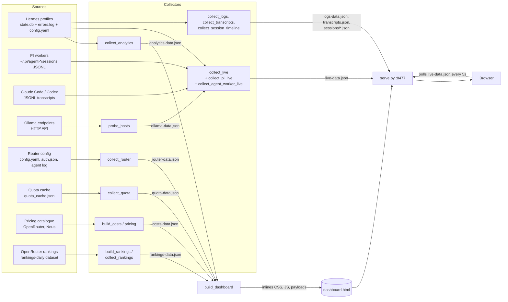

# Architecture

## Principle

Python collects; the browser renders; a versioned JSON contract sits between
them. This is the decision recorded in
[ADR 0001](adr/0001-language-and-runtime-split.md) (status in the file:
*proposed*; the code follows it). There is no application server: collectors run
on timers and write static JSON and HTML, and any HTTP server (or `file://`)
can show the result.

## Components

| Component | Location | Role |
|---|---|---|
| Config | `src/llm_telemetry/config.py` | Resolves config file, agent home, profiles (autodiscovery + config + exclude) |
| Collectors | `src/llm_telemetry/collect_*.py` (15 modules), `probe_hosts.py`, `pricing.py` | Read sources, write JSON payloads to the reports dir |
| Pure helpers | `alerts.py`, `bandwidth.py`, `context_compaction.py`, `cost_attribution.py`, `delegations.py`, `energy.py`, `failures.py`, `latency.py`, `session_timeline.py`, `tool_outcomes.py`, `agents_alive.py`, `projects.py` | Math and rules, unit-tested without a database |
| Analytics store | `analytics_store.py`, `ingest_all.py`, `ingest_pi.py` | Durable SQLite store filled by the `ingest` commands |
| Schema | `src/llm_telemetry/schema.py`, `schema/*.schema.json`, `schema_check.py` | `SCHEMA_VERSION = 2`; JSON-schema subset validated at write time |
| Builder | `build_dashboard.py`, `webassets.py` | Inlines CSS, JS and payloads into one HTML file |
| Front end | `src/llm_telemetry/web/` (`dashboard.html` shell, `css/`, `js/`) | Static assets; 11 ES modules in `web/js/` |
| Server | `serve.py` | Static server with no-store headers and one settings write endpoint |
| CLI | `cli.py` (`llm-telemetry`) | One entry point mapping subcommands to modules |
| Preflight | `doctor.py` | Read-only health check of the whole chain |
| Timers | `systemd/*.service`, `*.timer` | Schedules for build, probe, router, quota, rankings, serve |

Front-end modules (`web/js/`): `palette`, `charts`, `views`, `flow`, `drawer`,
`diffdom`, `live`, `routerview`, `quotaview`, `router`, `main`. They are plain
ES modules; `webassets.py` inlines them in the order in
`web/js/order.json`, dropping imports and `export` keywords, so the shipped page
is one file with no bundler and no network dependency for its own code.

## Data flow

### Two refresh paths

1. **Full rebuild** (about every 60 s, `llm-telemetry-build.timer`): the build
   unit runs `dashboard`, `quota`, `live`, `logs`, `costs`, `rankings`,
   `transcripts`, `session-timeline` in order (`systemd/llm-telemetry-build.service`).
   `build_dashboard` embeds `analytics-data.json`, `router-data.json`,
   `quota-data.json`, `costs-data.json` and `rankings-data.json` straight into
   `dashboard.html`.
2. **Fast live poll** (default every 5 s, `live_poll_interval_s`): the page
   fetches the small `live-data.json` and repaints only the live parts, so
   charts built from the full payload are not rebuilt on each tick
   (`web/js/live.js`, `LIVE_MS_DEFAULT = 5000`). The page also swaps in fresh
   full data in place (no page reload, so tab, profile and range survive) every
   `analytics_rebuild_interval_s` (default 60 s). Note: in the shipped systemd
   setup the *file* `live-data.json` is rewritten by the one-minute build
   cycle (the `live` step), so a 5 s poll sees new content at most once a minute
   unless `llm-telemetry live` is also run more often (**to confirm** for any
   given deployment). The Ollama host data inside it is the 5 s probe cache.

The host probe (`probe_hosts`) runs on its own 5-second timer because GPU
residency and queue depth change inside a single request. Telemetry carries an
`age`, so a dead probe shows as stale rather than as a confident old snapshot.

## Payload contract

- Every payload carries `schema_version` (`src/llm_telemetry/schema.py`).
  `build_dashboard.py` refuses to build from a payload with a different version
  and the page refuses to render a mismatch (`schemaProblem` in `views.js`).
- Collectors validate a payload against `schema/<tag>.schema.json` before
  writing, using a stdlib validator (`schema_check.py`) that implements `type`,
  `required`, `properties`, `items`, `additionalProperties` and errors on any
  other keyword. Schemas exist for `analytics`, `live`, `ollama`, `router`.
- `tests/bless.js --check` compares the structural signature of the committed
  sample payloads against frozen golden copies in `tests/fixtures/golden/`.
- Numbers are `number`, never `integer`; fields only some records carry are
  typed when present but not `required`.

## Privacy and safety choices (verified in code)

- Quota collector copies a whitelist of fields only and scrubs credential-shaped
  strings (`collect_quota.py`); the router collector copies only descriptive
  auth fields (`collect_router.py`).
- Claude/Codex/PI live collectors extract metadata only (session id, model,
  timestamps, token counts, coarse phase); message text and tool arguments are
  not copied (`collect_agent_worker_live.py`).
- Hermes live titles may come from the first user message (only when the
  session has no real title); credential-shaped strings are redacted before the
  text is cleaned and cut to 80 characters (`collect_live.py` `clean_title`).
  Claude/Codex/PI titles are the working-directory basename only.
- `serve.py` accepts config writes only from loopback clients, requires a custom
  header, whitelists numeric keys and writes atomically.
- `examples/check_no_leaks.py` scans committed samples, rendered pages and the
  schema directory for identifying patterns; CI runs it.

## Why static files

ADR 0001 rejected a dynamic server (FastAPI/Flask), a bundler and a Node
rewrite. Collectors are fast (the ADR measured 0.36 s for analytics against a
2.2 GB database), so there is no need for request-time queries, and a static
artifact keeps "clone and open" true.
