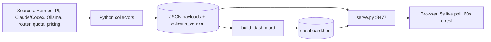

# Artifact brief — one-page fact sheet

For building a presentation or explainer. Every number below was counted from
the repo at `087bc44` (main); commands to re-check are in the last section.

## Tagline

**One page for your whole LLM fleet — live sessions, spend, failures and
routing, from data you already have.**

## The pitch in three sentences

LLM Telemetry reads what your agents already write (Hermes databases, PI,
Claude Code and Codex transcripts, Ollama, router config, quota cache) and
renders it as a single self-contained `dashboard.html` that refreshes itself.
It answers: what is running now, which host is saturated, what did it cost, and
why did that request fail. No agent instrumentation, no sidecar, no hosted
service; the only runtime dependency is PyYAML.

## Key numbers (verified)

| Fact | Value |
|---|---|
| Dashboard views | **13** (Home, Flow, Router, Quota, Usage, Sessions, Cost, Prices, Rankings, Health, Detail, Logs, Settings) in 3 nav groups |
| Collector modules (`collect_*.py`) | **15**, plus `probe_hosts.py` and `pricing.py` |
| Agent sources shown live | **4** kinds: Hermes, PI, Claude Code, Codex (+ Ollama hosts) |
| CLI commands | **16** (`config`, `doctor`, `dashboard`, `costs`, `rankings`, `live`, `transcripts`, `session-timeline`, `logs`, `probe`, `analytics`, `router`, `quota`, `serve`, `ingest`, `ingest-pi`) |
| Alert rules | **8** (`alerts.py`) |
| Payload schemas | **4** (analytics, live, ollama, router); `SCHEMA_VERSION = 2` |
| systemd units | **5 timers**, **6 services** (build, probe, router, quota, rankings, serve) |
| Python source | 45 modules, about 9.8k lines in `src/llm_telemetry/*.py` |
| Front end | 11 ES modules, about 9.3k lines of JS, 2 CSS files |
| JS test suites | **135** (116 `check_*`, 1 `drive_*`, 18 `unit_*.mjs`) |
| Python test suites | **60** (`tests/test_*.py`) |
| Runtime dependencies | **1** (PyYAML) |
| Page-weight budget | `dashboard.html` ≤ **960,000 bytes** |
| Refresh | page live poll 5 s; full rebuild 60 s; Ollama probe 5 s; router / quota / rankings hourly |
| Default port | **8477** |
| Repo history | 303 commits, first on 2026-09-25 |

## Feature highlights

1. **Live board** — sessions in flight, agents alive, 5-minute throughput, active alerts; a Depot → On the line → Yard "railway" task queue directly under them; a sortable session table across Hermes / PI / Claude / Codex (including agent-worker logins) where every row shows its owner, source and short session id.
2. **Spend you can trust** — metered, subscription and local costs kept distinct. Local models are costed from electricity. Claude Code / Codex sessions show the API-price equivalent labelled *covered by subscription* and never added to Est. cost. Unpriced cloud models raise a warning instead of silently counting as $0.
3. **Health** — success rate by model, tool reliability, session outcomes (orphan reaps, silent endings), delegated-run completion, grouped failures.
4. **Routing and quota** — per-profile model router (tiers, fallbacks, decisions) and provider quota headroom, with no credentials ever read by the dashboard.
5. **Fleet inventory** — GPU/VRAM/queue per physical Ollama host, de-duplicated across aliases.
6. **Investigation tools** — Session finder (`/`), session timelines, transcript modal, searchable Logs, Live tail drawer (`L`), CSV export, project / provider / model cross-filters.
7. **Prices and Rankings** — the exact per-1M rate behind every number, a what-if calculator, and OpenRouter's public top-model rankings.
8. **Calm UX** — dark Grafana-style theme (light available), stable colour per model, completion and critical-alert sounds (on by default, one-click toggle), keyboard shortcuts, responsive from 375 to 1920 px.

## Architecture in one paragraph

Python collectors (stdlib + PyYAML) run on systemd timers, read the agent
sources, validate each payload against a versioned JSON schema and write static
JSON. `build_dashboard.py` inlines the CSS, 11 plain ES modules and the payloads
into one `dashboard.html`. A tiny no-store HTTP server (`serve.py`, port 8477)
serves it; the browser polls a small `live-data.json` every 5 s and swaps in the
full data every 60 s. No application server, no bundler, no database at request
time (ADR 0001).



## Design principles worth a slide

- Read existing data; instrument nothing.
- Static artifact; clone and open.
- Contracts over conventions: schema version, golden fixtures, leak gate.
- Never invent a number: unknown prices show "—" or a warning, not $0.
- Privacy by whitelist: metadata only, no prompts, no secrets.

## Caveats to state honestly

- The repo has no screenshots committed; capture them from the sample page (see [overview.md](overview.md#screenshots)).
- The live file is rewritten once a minute by the shipped build timer; the 5 s figure is the page's poll interval (see [architecture.md](architecture.md)).
- Roadmap is not in the repo (see [roadmap.md](roadmap.md)).

## Re-check the numbers

```bash
ls src/llm_telemetry/collect_*.py | wc -l            # 15
grep -c 'data-view=' src/llm_telemetry/web/dashboard.html   # 13
ls tests/check_*.js | wc -l; ls tests/unit_*.mjs | wc -l    # 116, 18
ls tests/test_*.py | wc -l                            # 60
ls systemd/*.timer | wc -l; ls systemd/*.service | wc -l   # 5, 6
```
